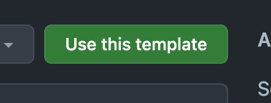
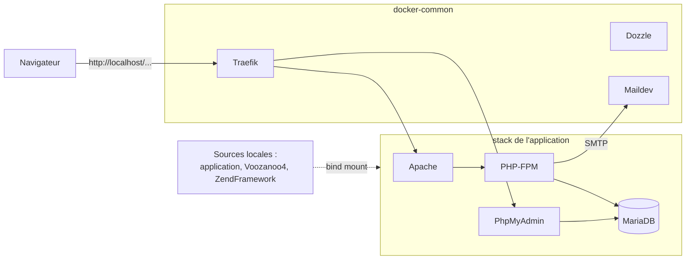

<p align="center">
 
  <h1 align="center">Voo4Skeleton</h1>
  <h5 align="center">Squelette d'une application Voozanoo 4
  </h5>
</p>

---

Voo4Skeleton est le template GitHub des nouvelles applications Voozanoo 4 : une application minimale qui démarre, avec les fichiers de configuration attendus par le noyau.

C'est un **template pur** : il ne contient ni workflow GitHub ni chaîne de build. Un projet créé à partir de lui n'a rien à nettoyer.

## Contenu

| Chemin | Rôle |
| --- | --- |
| `Bootstrap.php` | Bootstrap de l'application (hérite du bootstrap du noyau) |
| `configs/APPINFOS` | Identité et packaging de l'application : section `PACKAGING` (`INF_PACKAGE`, version…) et section `DEPENDENCIES` |
| `configs/env.php` | Chemins du noyau Voozanoo4, de ZendFramework et de la ferme |
| `controllers/`, `views/` | Contrôleur et page d'accueil par défaut |
| `modules/` | Modules de l'application (vide) |
| `public/` | Racine web : `index.php` (contrôleur frontal), `.htaccess`, logo, exemples JS |
| `resources/cron/` | Points d'entrée CLI : `voo4_cli.php` (tâches, tests, healthcheck) et `sys_cli.php` (réservé aux équipes infra et FWK, ne pas modifier) |
| `resources/xml/`, `resources/translation/` | Configuration YUI des modules, traductions |
| `docs/ChangeLog` | Journal des évolutions de l'application |

## Créer une nouvelle application

### 1. Créer le repository

Depuis cette page, bouton **Use this template** :



### 2. Configurer le projet

Dans le nouveau repository :

- [ ] créer `configs/application.ini`, avec au minimum une section `[production]` (le fichier est propre à chaque environnement) ;
- [ ] adapter `configs/APPINFOS` : dans la section `PACKAGING`, `INF_PACKAGE` (nom du paquet, `voo4skeleton` par défaut), `INF_DESCRIPTION` et `INF_VERSION` ; dans la section `DEPENDENCIES`, les versions des dépendances (`VOOZANOO4`), à garder cohérentes avec `INF_DEPENDS` ;
- [ ] vérifier les chemins de `configs/env.php` ;
- [ ] remplacer ce README par celui du projet (le logo et la capture de `docs/` peuvent être supprimés) ;
- [ ] tenir `docs/ChangeLog` à jour au fil des évolutions.

Exemple minimal de `configs/application.ini` :

```ini
[production]

[development : production]
```

## Développement local

L'environnement local standard est [fwk-docker-stack-dev](https://github.com/Epiconcept-Paris/fwk-docker-stack-dev). Il comprend deux parties :

- `docker-common`, une stack commune à toutes les applications : Traefik, Dozzle (logs), Maildev ;
- `docker-app-template`, une stack applicative à copier dans le repository de l'application : Apache, PHP-FPM, MariaDB, phpMyAdmin.

Le code de l'application, un clone de [Voozanoo4](https://github.com/Epiconcept-Paris/Voozanoo4) et un clone de [ZendFramework](https://github.com/Epiconcept-Paris/ZendFramework) sont montés dans les conteneurs.



### Mise en place

1. **Stack commune** : une seule fois par machine, depuis `fwk-docker-stack-dev` :

   ```bash
   cd docker-common
   docker network create local-dev-stack
   docker compose up -d
   ```

2. **Stack applicative** : depuis la racine du repository de l'application :

   ```bash
   cp -R /chemin/vers/fwk-docker-stack-dev/docker-app-template/* ./
   cp docker-compose.override.example.yml docker-compose.override.yml
   ```

   - Dans `docker-compose.override.yml`, qui est ignoré par Git, renseigner les chemins locaux de l'application, de Voozanoo4 et de ZendFramework.
   - Remplacer les placeholders `myapp` (nom de l'application) et `myproject` (nom du projet) dans les fichiers ajoutés.

3. **Section `[development]`** de `configs/application.ini` : au minimum `voozanoo.host`, `voozanoo.baseurl`, l'hôte de la base (`<application>-mariadb`), le mail vers `fakemail:1025`, et un nom de session propre à l'application. Le détail est dans le [README de docker-app-template](https://github.com/Epiconcept-Paris/fwk-docker-stack-dev/blob/main/docker-app-template/README.md).

4. **Démarrage** :

   ```bash
   docker compose up -d
   ```

   L'application est alors servie sur `http://localhost/<application>/<projet>/`, ou `http://localhost/<projet>` si les deux noms sont identiques. phpMyAdmin est sur `http://localhost/<application>-phpmyadmin/`, les logs sur `http://localhost/logs/` et les mails sur `http://localhost/mail/`.

## Images Docker

Les images `ghcr.io/epiconcept-paris/voo4skeleton:*`, qui servent d'image de base aux modules métier, sont construites dans [fwk-docker-images](https://github.com/Epiconcept-Paris/fwk-docker-images). Leur documentation (tags, variables d'environnement, healthcheck, cron) est dans [images/voo4skeleton/README.md](https://github.com/Epiconcept-Paris/fwk-docker-images/blob/main/images/voo4skeleton/README.md).

## Maintenir ce template

- Tout ce qui est ajouté ici est hérité par chaque nouvelle application : aucun workflow, aucune chaîne de build, aucun fichier propre au template.
- fwk-docker-images embarque sa propre copie de cette application minimale (`images/voo4skeleton/app/`). Une modification qui doit aussi se retrouver dans les images est à reporter là-bas.
